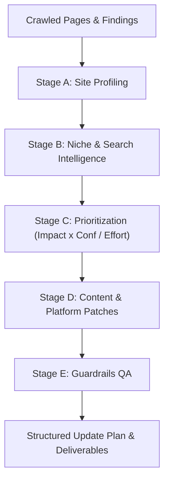

# SearchScope AI Agent Mode: Architecture & Specification

## 1. Executive Summary

SearchScope AI Agent is an autonomous, platform-aware technical SEO, AEO (Answer Engine Optimization), and GEO (Generative Engine Optimization) strategist. It bridges the gap between passive diagnostic reporting and actionable code implementation.

Instead of generic advice, the agent analyzes real crawled pages, determines the site's tech stack (e.g., Next.js App Router, Shopify, WordPress, Webflow), profiles the brand voice, uncovers content and schema gaps, and emits publish-ready code patches, unified diffs, and structured update plans.

---

## 2. Core Architectural Principles

### 2.1 Strict Zero-Hallucination Guardrails
- **Grounding Requirement:** The agent is strictly prohibited from inventing product attributes, ingredients, guarantees, return windows, phone numbers, or physical addresses not explicitly present in the crawled data.
- **Confirmation Placeholders:** Any unconfirmed claim or parameter is automatically wrapped in `[[CONFIRM: <what to verify>]]` placeholders.
- **Banned Claim Interceptor:** Superlatives such as "world's best", "#1 in the world", "guaranteed overnight", or unverified medical claims are intercepted and flagged for human confirmation.
- **Character Length Enforcement:**
  - Titles: 50–60 characters (strict hard max 65)
  - Meta descriptions: 140–155 characters (strict hard max 160)
  - H1 headings: Singular, 30–70 characters

### 2.2 Bring Your Own Key (BYOK) & Privacy
- **Zero Server Storage:** SearchScope operates with no database, no session persistence, and no disk logging of user credentials.
- **Transient Memory:** User-supplied API keys live solely in client-side React memory for the active tab and are forwarded in transient request payloads.
- **Automatic PII Redaction:** Emails, credit card patterns, and phone numbers are scrubbed from page snippets before prompts are constructed.
- **Prompt Injection Defense:** Crawled snippets are sanitized to neutralize injection payloads (e.g. `ignore previous instructions`, `system prompt:`) and enclosed within structured boundary delimiters.

### 2.3 Provider-Agnostic LLM Engine
SearchScope supports 8 provider configurations:
1. **Google Gemini:** Free tier supported (`gemini-1.5-flash`, `gemini-2.0-flash`)
2. **Groq:** Ultra-fast Llama-3 inference with free tier
3. **OpenRouter:** Multi-model gateway (Claude, Llama, Gemini, DeepSeek)
4. **Anthropic Claude:** Claude 3.5 Sonnet / Haiku
5. **Mistral AI:** Mistral Small and Large
6. **OpenAI Compatible:** Any custom or enterprise endpoint
7. **Ollama:** Local, private inference on `localhost:11434`
8. **Mock Provider:** 100% deterministic, offline test provider requiring zero credentials or internet access

---

## 3. The 5-Stage Agent Pipeline



### Stage A: Site Profiling (`SiteProfile`)
- Detects the web framework (Next.js App Router, Shopify, etc.).
- Identifies niche, sub-niche, price positioning (`luxury_premium`, `mid_market`, `budget_value`), brand voice, verified USPs, and audience personas.

### Stage B: Niche & Search Intelligence (`NicheInsights`)
- Uncovers high-opportunity topic clusters, customer question intents for AEO, competitor SERP patterns, and content gaps.

### Stage C: Prioritization
- Evaluates findings with:
  $$\text{Priority Score} = \frac{\text{Impact} \times \text{Confidence}}{\text{Effort}}$$
- Assigns priority tiers (`P0`, `P1`, `P2`, `P3`), t-shirt sizes (`S`, `M`, `L`), and ownership (`dev`, `content`, `seo`).

### Stage D: Content & Platform Code Generation
- Generates grounded title fixes, meta descriptions, direct answer paragraphs (40–60 words), and Schema.org JSON-LD (Product, FAQPage, Organization).
- Resolves exact platform-specific paths (e.g., `app/product/[slug]/page.tsx` for Next.js App Router).
- Creates site-wide configuration files:
  - `robots.txt` (respecting AI crawler discovery policy)
  - `llms.txt` (standardized LLM context manifest)
  - `root-organization-schema.json`
  - High-intent content creation briefs.

### Stage E: Guardrails QA
- Executes deterministic length checks.
- Scans and extracts all `[[CONFIRM: ...]]` tags into an actionable Owner Checklist.
- Validates JSON-LD schema syntax.
- Generates the QA summary metrics.

---

## 4. Deliverables & Output Formats

| File | Purpose | Audience |
|---|---|---|
| `UPDATE_PLAN.md` | Strategic executive roadmap with site profile, key gaps, backlog table, and confirmation checklist | Product Owners & Marketing Leads |
| `AGENT_TASKS.md` | Dev-ready tasks with exact file locations, code snippets, and unified diffs | Engineers & AI Coding Agents (Cursor, Claude Code) |
| `update-plan.json` | Validated JSON dataset conforming to `docs/update-plan.schema.json` | Automation pipelines & CI/CD |
| `update-plan.csv` | Tabular backlog of every proposed change with locations and rationale | Spreadsheets & Project Management |
| `content-pack/*.md` | Ready-to-publish content briefs and site-wide files (`robots.txt`, `llms.txt`) | Content Writers & Devs |
| `*.zip` | Complete client-side zipped bundle of all agent deliverables | One-click distribution |

---

## 5. Next.js App Router Integration Example (`kingshyer.com`)

For sites running Next.js App Router (such as `kingshyer.com`), SearchScope generates tailored TypeScript diffs:

```diff
--- app/product/[slug]/page.tsx (Metadata)
+++ Proposed generateMetadata()
 export async function generateMetadata({ params }: Props): Promise<Metadata> {
   return {
-    title: "Midas Reserve",
-    description: "",
+    title: "Midas Reserve Pure Attar | Luxury Fragrance | Kingshyer",
+    description: "Discover Kingshyer's Midas Reserve pure artisanal attar oil. Alcohol-free, long-lasting formulation crafted with authentic premium notes. Shop online.",
   };
 }
```
